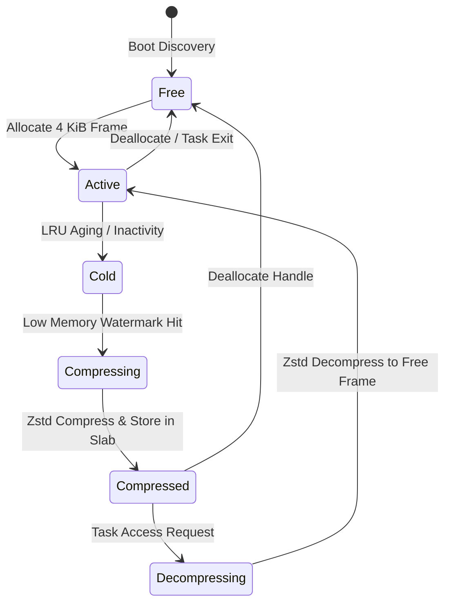

# ramOS Architectural Specification

## 1. Executive Summary
**ramOS** is a specialized bare-metal operating system for AArch64 where physical RAM is the sole storage and execution tier. It eliminates secondary storage swap, eliminates per-process page tables, and eliminates TLB flushes by combining:
1. **Single Flat 64-bit Address Space:** All tasks and kernel code share the Limine Higher-Half Direct Map (HHDM).
2. **In-RAM Zstandard Compression Ring:** Cold physical frames are dynamically compressed into an in-memory slab pool when memory pressure rises.
3. **Software-Enforced Memory Safety:** Isolation is enforced at the language level by Zig's compile-time types and `ReleaseSafe` runtime bounds checking.

---

## 2. Memory Topology & Layout

Limine maps all available physical memory to a higher-half virtual base (`HHDM_OFFSET`). ramOS partitions the usable physical RAM reported by the Limine Memory Map into two dynamic zones:

```
+-----------------------------------------------------------------------+
|                       Total Physical Memory                           |
+-----------------------------------+-----------------------------------+
|     Active Physical Frames        |       Compressed Slab Pool        |
|  (4 KiB Hot/Uncompressed Pages)   |    (Variable-length Zstd Chunks)  |
+-----------------------------------+-----------------------------------+
```

- **Active Physical Frame Pool:** Backs active execution, stacks, task heaps, and kernel data structures.
- **Compressed Slab Pool:** Houses cold pages compressed via Zstandard. Allocated in 64 KiB or 256 KiB slab blocks to minimize external fragmentation.
- **Fixed Scratch Arena:** A pre-allocated, unpageable memory buffer reserved strictly for Zstandard compression/decompression working state to prevent OOM recursion during compression.

---

## 3. Page Lifecycle & Compression State Machine

Every physical frame tracked by ramOS possesses a corresponding entry in the global `FrameTable`:



### Frame States:
- **`Free`:** Available in the physical buddy/bitmap allocator.
- **`Active`:** In active use by a task.
- **`Cold`:** Inactive, candidate for compression when low-water mark is hit.
- **`Compressing`:** Currently enqueued or processing in the compression ring.
- **`Compressed`:** Uncompressed frame returned to `Free`; data stored as a compact slice in the slab pool with a `PageHandle`.
- **`Decompressing`:** Restored synchronously when accessed.

---

## 4. In-Memory Compression Ring Buffer

To prevent memory allocation deadlocks when memory is scarce, compression operates via a lockless circular ring buffer with pre-allocated scratch memory:

1. **Pre-allocated Zstd Context:** `ZSTD_CCtx` and `ZSTD_DCtx` structures are initialized at boot in reserved memory. No heap allocations occur inside the compression path.
2. **Synchronous Eviction Path:** When available free physical frames drop below `WATERMARK_LOW` (e.g., 10% of physical RAM), any subsequent allocation call triggers synchronous compression of the oldest `Cold` pages until free frames exceed `WATERMARK_HIGH` (e.g., 20%).
3. **Zero Disk I/O:** Eviction latency is purely the CPU throughput of Zstandard decompression/compression (~hundreds of MB/s to GB/s on modern AArch64 cores).

---

## 5. Single Flat Address Space & Task Model

1. **Unified Mapping:** Hardware translation table base registers (`TTBR0_EL1` / `TTBR1_EL1`) are configured once at boot by Limine and remain unchanged throughout system lifetime.
2. **Zero TLB Flushes:** Context switches save and restore only general-purpose registers (`x0-x30`, `sp`, `pc`) and SIMD registers. No `TLBI` (TLB Invalidate) instructions are executed.
3. **Safety Layer:**
   - Without hardware MMU page permission bits between tasks, safety and memory bounds are strictly enforced by Zig's compile-time types, slice bounds checking, and `ReleaseSafe` panic traps.
   - Pointers across tasks are managed through capability-style handles or borrow-checked abstractions.

---

## 6. Phased Implementation Plan

- **Phase 1: Boot & Limine Memory Discovery**
  - Parse Limine Memory Map into physical memory regions.
  - Initialize the global `FrameTable` and physical bitmap/buddy allocator.
- **Phase 2: In-RAM Slab Allocator**
  - Implement fixed-size slab caches for variable-length compressed payloads.
- **Phase 3: Zstd Compression Engine Integration**
  - Embed bare-metal Zstandard with static workspace memory.
- **Phase 4: Compression Ring & Watermark Eviction**
  - Connect frame allocator watermarks to synchronous cold page compression.
- **Phase 5: Single Flat Space Task Switcher**
  - Implement cooperative/preemptive green threads sharing the flat address space.
