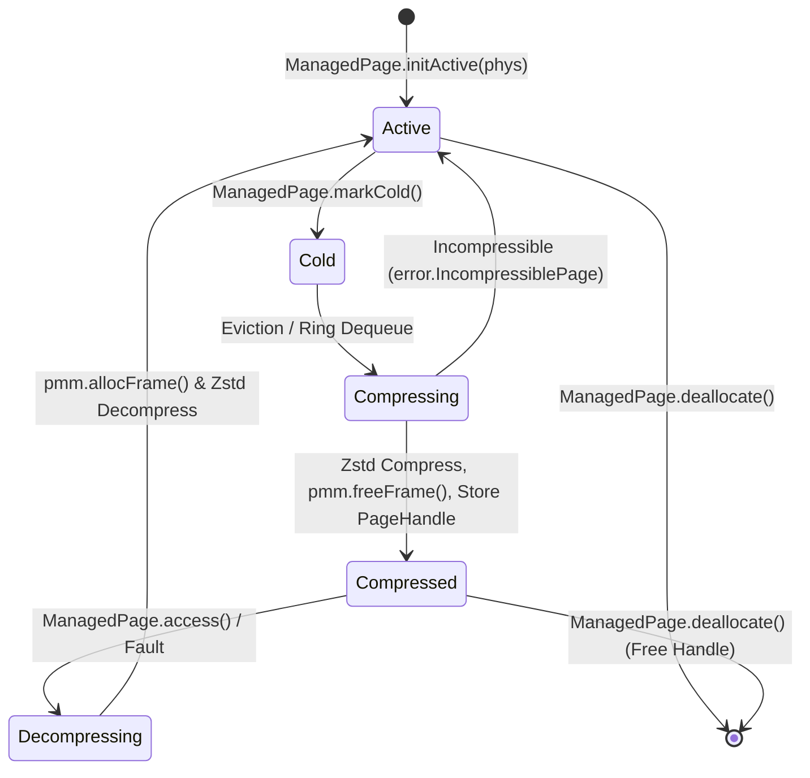

# ramOS Architectural Specification

## 1. Executive Summary
**ramOS** is a specialized bare-metal operating system for AArch64 where physical RAM is the sole storage and execution tier. It eliminates secondary storage swap, eliminates per-process page tables, and eliminates TLB flushes by combining:
1. **Single Flat 64-bit Address Space:** All tasks and kernel code share the Limine Higher-Half Direct Map (HHDM).
2. **In-RAM Zstandard Compression Ring:** Cold physical frames are dynamically compressed into an in-memory slab pool when memory pressure rises.
3. **Software-Enforced Memory Safety:** Isolation is enforced at the language level by Zig's compile-time types and `ReleaseSafe` runtime bounds checking.

---

## 2. Memory Topology & Layout

Limine maps all available physical memory to a higher-half virtual base (`HHDM_OFFSET`). ramOS partitions the usable physical RAM reported by the Limine Memory Map into two dynamic zones:

```
+-----------------------------------------------------------------------+
|                       Total Physical Memory                           |
+-----------------------------------+-----------------------------------+
|     Active Physical Frames        |       Compressed Slab Pool        |
|  (4 KiB Hot/Uncompressed Pages)   |    (Variable-length Zstd Chunks)  |
+-----------------------------------+-----------------------------------+
```

- **Active Physical Frame Pool:** Backs active execution, stacks, task heaps, and kernel data structures.
- **Compressed Slab Pool:** Houses cold pages compressed via Zstandard. Allocated in 64 KiB or 256 KiB slab blocks to minimize external fragmentation.
- **Fixed Scratch Arena:** A pre-allocated, unpageable memory buffer (128 KiB) reserved strictly for Zstandard compression working state (`ZSTD_CCtx`) to prevent OOM recursion during compression. Decompression (`ZSTD_DCtx`) operates without workspace memory overhead, streaming directly into destination frames.

---

## 3. Page Lifecycle & Compression State Machine

Page state tracking in ramOS cleanly decouples physical frame allocation (`PhysicalMemoryManager` / `FrameTable`) from the virtual page lifecycle (`ManagedPage`):

- **Physical FrameTable (`PhysicalMemoryManager.frame_table`):** Tracks the physical allocation state of 4 KiB frames in RAM (`free`, `active`, `cold`, `compressing`, `decompressing`, `reserved`). Physical frames never remain in a compressed state: once a page is compressed into the slab pool, its physical frame is returned immediately to `PhysicalMemoryManager.freeFrame()`, resetting its physical frame entry to `free`.
- **Managed Virtual Pages (`ManagedPage`):** Owns the virtual lifecycle and holds the `PageHandle` referencing the compressed chunk in the slab pool once the physical frame is released back to PMM.



### ManagedPage States:
- **`Active`:** Backed by an active physical frame (`phys_addr != 0`, `handle = invalid`).
- **`Cold`:** Inactive, candidate for compression when low-water mark is hit.
- **`Compressing`:** Currently processing in the compression ring. If compression fails due to high entropy (`error.IncompressiblePage`), transitions back to `Active` to prevent repetitive eviction sweeps.
- **`Compressed`:** Physical frame freed back to PMM (`phys_addr = 0`); payload stored as a compact slice in the slab pool with a `PageHandle`.
- **`Decompressing`:** Synchronously allocating a fresh physical frame from PMM and restoring payload.
- **`Free`:** Unallocated / deallocated upon task exit.

### Physical Frame States (`FrameTable`):
- **`Free`:** Available in the physical bitmap allocator for allocation.
- **`Active`:** Assigned to an active ManagedPage, stack, or kernel structure.
- **`Cold`:** Active page marked cold; physical candidate for eviction.
- **`Compressing` / `Decompressing`:** Transient physical frame states during active (de)compression.
- **`Reserved`:** Hardware/firmware memory, MMIO, or early boot reservations.

---

## 4. In-Memory Compression Ring Buffer

To prevent memory allocation deadlocks when memory is scarce, compression operates via a lockless circular ring buffer with pre-allocated scratch memory:

1. **Pre-allocated Zstd Context:** `ZSTD_CCtx` (128 KiB scratch arena) and `ZSTD_DCtx` (lean struct without workspace overhead) structures are initialized at boot in reserved memory. No heap allocations occur inside the compression path. The encoder guarantees full input coverage (`src_pos == src.len`) and frame header accounting (`out_pos + total_block_bytes < src.len`), falling back to canonical single raw blocks on workspace exhaustion or frame expansion. Decompression decodes directly into destination frames using idiomatic Zig error unions.
2. **Synchronous Eviction Path:** When available free physical frames drop below `WATERMARK_LOW` (e.g., 10% of physical RAM), any subsequent allocation call triggers synchronous compression of the oldest `Cold` pages until free frames exceed `WATERMARK_HIGH` (e.g., 20%).
3. **Zero Disk I/O:** Eviction latency is purely the CPU throughput of Zstandard decompression/compression (~hundreds of MB/s to GB/s on modern AArch64 cores).

---

## 5. Single Flat Address Space & Task Model

1. **Unified Mapping:** Hardware translation table base registers (`TTBR0_EL1` / `TTBR1_EL1`) are configured once at boot by Limine and remain unchanged throughout system lifetime.
2. **Zero TLB Flushes:** Context switches save and restore only general-purpose registers (`x0-x30`, `sp`, `pc`) and SIMD registers. No `TLBI` (TLB Invalidate) instructions are executed.
3. **Safety Layer:**
   - Without hardware MMU page permission bits between tasks, safety and memory bounds are strictly enforced by Zig's compile-time types, slice bounds checking, and `ReleaseSafe` panic traps.
   - Core kernel tables (`PhysicalMemoryManager.bitmap: []u8`, `PhysicalMemoryManager.frame_table: []FrameMeta`, `CompressionRing.slots: []RingSlot`, and `PageHandleManager.entries: []HandleEntry`) are stored as bounded slices sliced once during initialization rather than unchecked multi-item pointers (`[*]T`), activating runtime bounds checking against silent buffer overruns.
   - Pointers across tasks are managed through capability-style handles or borrow-checked abstractions.
4. **Task Scheduling & Slot Lifecycle:**
   - Tasks are scheduled via cooperative round-robin across a bounded task table.
   - Round-robin search (`findNextReadyTask`) strictly inspects active/ready task slots (`state != .unused`) when locating the predecessor task index to prevent recycled or default-initialized unused slots from hijacking the search start index.
   - Terminated tasks defer stack deallocation to `reclaimZombie` executed on the next scheduled task context, recycling the slot to `.unused` without leaking task slots.
   - To eliminate kernel `.bss` bloating, `Scheduler` gates mock test stacks (`static_stacks: [MAX_TASKS][16 KiB]u8`, 1 MiB) behind `builtin.is_test`, allocating only a single 16 KiB `idle_stack` for freestanding kernel context switching.

---

## 6. Phased Implementation Plan

- **Phase 1: Boot & Limine Memory Discovery**
  - Parse Limine Memory Map into physical memory regions.
  - Initialize the global `FrameTable` and physical bitmap/buddy allocator.
- **Phase 2: In-RAM Slab Allocator**
  - Implement fixed-size slab caches for variable-length compressed payloads.
- **Phase 3: Zstd Compression Engine Integration**
  - Embed bare-metal Zstandard with static workspace memory.
- **Phase 4: Compression Ring & Watermark Eviction**
  - Connect frame allocator watermarks to synchronous cold page compression.
- **Phase 5: Single Flat Space Task Switcher**
  - Implement cooperative/preemptive green threads sharing the flat address space.
